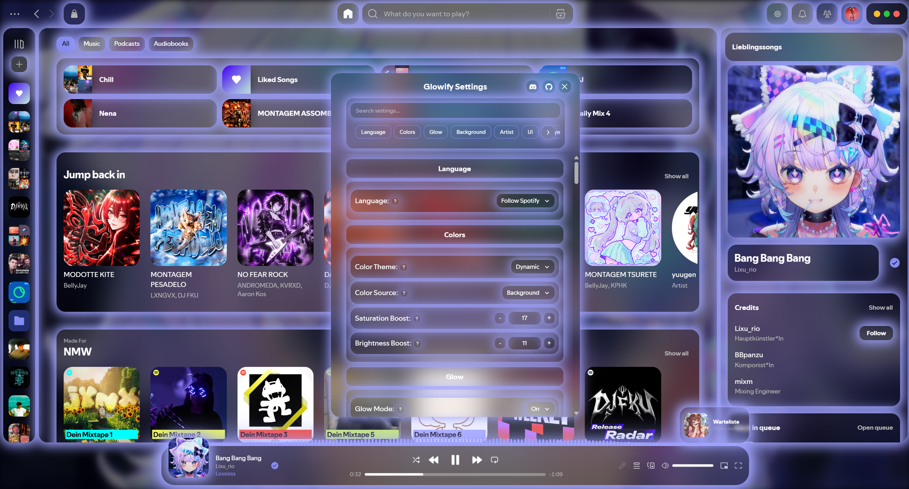

<h1 align="center"> ✨ Glowify Theme Spicetify ✨ </h1>

  <b>A modern, rounded and glowified theme for spicetify</b> 

## Contents

<!-- toc -->

- [Introduction](#introduction)
- [Theme screenshots](#theme-screenshots)
- [Features](#features)
- [Installation](#installation)
<!-- tocstop -->

## Introduction

**Glowify** - is a glow-infused Spicetify theme for Spotify featuring a modern, luminous interface and smooth animations.

If your transparent controls don’t look fully transparent — for example when zooming in on Spotify — you can easily change the width and height of them in the Glowify Settings to make them fully transparent again.

If you like the theme, consider starring the repository on GitHub! ⭐

**For support join the Discord!**:

## Theme screenshots

Click to watch screenshots

---

## Features

**Glowify offers:**

- Many customization options
-  `Beatiful Lyrics`, `Spicy Lyrics` and `Lucid Lyrics` are supported by default
- Beautiful dynamic colors (Just enable dynamic button colors in the settings and your good to go)
- Modern, rounded UI
- And much more!

---

## Installation

Want to install the theme manually? [Just click here](https://nmw.it.com/projects/glowify/installation/)
And you will find a _detailed installation guide there_!

## Credits

Created by NMW.

## License

This project is licensed under the GNU Affero General Public License v3.0 (AGPL-3.0). See the LICENSE file for details.
